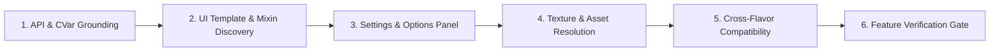

# WoW Addon Feature Development Skill

This skill guides an agent through implementing new features, frames, widgets,
settings panels, and API integrations for World of Warcraft addons using the
**wow** MCP server.

---

## 1. When to Use This Skill

Activate this skill whenever the task involves:

- Adding new user-facing functionality or gameplay logic to an addon.
- Building in-game UI components (frames, dialogs, buttons, list views, or
  status bars).
- Creating or updating configuration panels using the modern Settings API.
- Finding and referencing game assets (icons, texture atlases, FileDataIDs) or
  exporting texture previews.
- Writing cross-client compatibility logic across Retail (Midnight / The War
  Within), Classic progression, Classic Era, and WoW Forever.

---

## 2. Feature Development Workflow

Follow this 6-step workflow to implement addon features cleanly and without
hallucination:



---

### Step 1: In-Game API & CVar Grounding

Blizzard refactors and namespaces in-game Lua APIs across expansions (notably
10.0 Dragonflight, 11.0 The War Within, and 12.0 Midnight). **Never write WoW
API calls from memory.**

1. **Verify Signatures & Namespaces:** Call `wow_api_search` before invoking any
   function:

   ```json
   { "query": "C_Container.GetContainerItemInfo", "flavor": "mainline" }
   ```

   - Pay special attention to return types: many APIs return a single structured
     table (e.g., `ContainerItemInfo`, `SpellInfo`) rather than legacy
     multi-returns.
   - Check parameter nilability and field names in `wow_api_type_search`.
   - Inspect Midnight `secretReturns` and `secretArguments` flags: functions
     with `secretReturns: true` produce protected values that addon code cannot
     inspect or format.

2. **Verify Event Payloads:** When listening for events, verify argument
   ordering with `wow_api_event_search`:

   ```json
   { "query": "PLAYER_INTERACTION_MANAGER_FRAME_SHOW", "flavor": "mainline" }
   ```

3. **Verify Enums and Constants:** Call `wow_api_type_search` for `Enum.*` and
   `Constants.*` tables:

   ```json
   { "query": "ItemQuality", "flavor": "mainline" }
   ```

4. **Verify Console Variables (CVars):** Call `wow_cvar_search` before using
   `GetCVar` or `SetCVar` to inspect defaults, category, scope, and Blizzard's
   UI usage:

   ```json
   { "query": "nameplateShowAll", "flavor": "mainline", "usedOnly": true }
   ```

---

### Step 2: Blizzard-First UI Discovery

Blizzard's stock UI provides hundreds of battle-tested, localized XML templates
and Lua mixins. Reusing them ensures consistent aesthetics and reduces custom
code.

1. **Locate Shipped Packages:** Call `wow_ui_list_packages` to find which
   Blizzard addon manages relevant UI:

   ```json
   { "filter": "ActionBar", "flavor": "mainline" }
   ```

2. **Locate Virtual Templates:** Call `wow_ui_template_search` to find existing
   components:

   ```json
   { "query": "UIPanelButtonTemplate", "type": "Button", "flavor": "mainline" }
   ```

   Inspect the `chain` field to identify inherited properties and sub-elements.

3. **Find Reusable Mixins:** Call `wow_ui_mixin_search` to find behavior mixins:

   ```json
   { "query": "ScrollBox", "flavor": "mainline" }
   ```

4. **Inspect Real Shipped FrameXML Implementations:** Use `wow_ui_grep` and
   `wow_ui_read_file` to see how Blizzard structures similar features:

   ```json
   {
     "pattern": "ScrollUtil\\.InitDefaultScrollBoxListWithBar",
     "ext": "lua",
     "flavor": "mainline"
   }
   ```

   Read the file context (if an exact path misses, `wow_ui_read_file` suggests
   likely candidates):

   ```json
   {
     "path": "Interface/AddOns/Blizzard_SharedXML/Shared/Scroll/ScrollUtil.lua",
     "startLine": 50,
     "endLine": 90,
     "flavor": "mainline"
   }
   ```

---

### Step 3: Modern Settings & Options Panels

Retail (10.0+) replaced legacy `InterfaceOptions_AddCategory` with the modern
`Settings` API. Always check which pattern is appropriate for the target client.

#### Modern Retail (10.0+ / 11.0+ / 12.0+)

```lua
local category, layout = Settings.RegisterVerticalLayoutCategory("MyAddon")
Settings.RegisterAddOnCategory(category)

local function GetSettingValue() return MyAddonDB.enabled end
local function SetSettingValue(val) MyAddonDB.enabled = val end

local setting = Settings.RegisterAddOnSetting(
    category,
    "myaddon_enabled",
    "enabled",
    MyAddonDB,
    Settings.VarType.Boolean,
    "Enable Feature",
    true
)
Settings.CreateCheckbox(category, setting, "Check this to enable the feature.")
```

#### Classic / Legacy Fallback

If targeting Classic Era or supporting older clients, check availability with
`wow_api_search`:

```lua
if Settings and Settings.RegisterAddOnCategory then
    -- Modern Settings API
else
    -- Legacy InterfaceOptionsFrameAddOns
    local panel = CreateFrame("Frame", "MyAddonSettingsPanel", UIParent)
    panel.name = "MyAddon"
    InterfaceOptions_AddCategory(panel)
end
```

---

### Step 4: Texture and Asset Resolution

Never guess texture paths or invent hardcoded file strings.

1. **For Vector/Atlas UI Art:** Call `wow_atlas_search` with the target `flavor`
   to find atlas elements, sheet FileDataIDs, and dimensions:

   ```json
   { "query": "common-search-magnifyingglass", "flavor": "mainline" }
   ```

   In Lua:

   ```lua
   -- true preserves aspect ratio
   texture:SetAtlas("common-search-magnifyingglass", true)
   ```

2. **For Icons and Textures:** Call `wow_icon_search` to find the candidate
   texture and `FileDataID`:

   ```json
   { "query": "inv_misc_gem_bloodgem_01" }
   ```

   Always reverse-verify the numeric ID via `wow_file_search`:

   ```json
   { "query": "133850" }
   ```

   In Lua or `.toc` files, always include an inline comment documenting the
   texture name:

   ```lua
   texture:SetTexture(133850) -- FileDataID: inv_misc_gem_bloodgem_01
   ```

3. **Texture Previews and 3D Models:**
   - To inspect a `.blp` texture visually on your local machine, decode it to
     `.png` with `wow_texture_export`.
   - If the task requires full 3D models (creatures, props, buildings, or
     terrain), activate the `wow-model-export` skill.

---

### Step 5: Cross-Flavor Compatibility

When supporting multiple client flavors (Retail, Classic progression, Classic
Era, WoW Forever):

1. **Compare APIs Across Flavors:** Call `wow_api_diff` to verify function,
   event, or type availability across all four client indexes (`mainline`,
   `mists`, `vanilla`, `forever`):

   ```json
   { "name": "GetContainerNumSlots" }
   ```

2. **Branching Strategy:** Prefer capability/feature detection whenever
   possible:

   ```lua
   local GetNumSlots = (C_Container and C_Container.GetContainerNumSlots)
                       or GetContainerNumSlots
   ```

   When project branching is necessary, use `WOW_PROJECT_ID`:

   ```lua
   local isRetail = (WOW_PROJECT_ID == WOW_PROJECT_MAINLINE)
   local isVanilla = (WOW_PROJECT_ID == WOW_PROJECT_CLASSIC)
   local isMists = (WOW_PROJECT_ID == WOW_PROJECT_MISTS_CLASSIC)
   ```

---

### Step 6: Feature Verification Gate

Before concluding any feature task, validate all touched files:

1. **Lint Lua Code:** Call `wow_lua_lint` with the appropriate `flavor` and
   `knownGlobals`:

   ```json
   { "path": "Core.lua", "flavor": "mainline" }
   ```

   Ensure 0 errors and 0 unaddressed warnings across all targeted clients.

2. **Validate XML Templates:** If XML files were added or modified, call
   `wow_xml_validate`:

   ```json
   { "path": "Templates.xml" }
   ```
