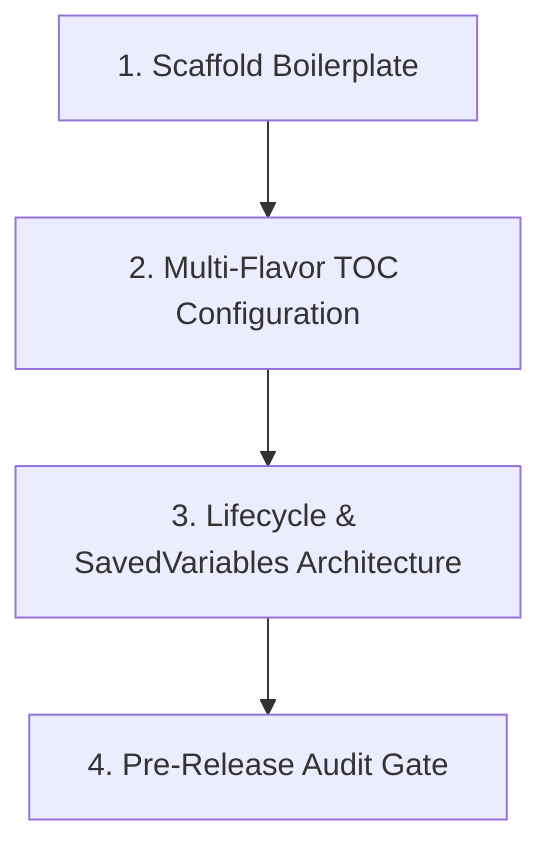

# WoW Addon Scaffolding, Architecture & Audit Skill

This skill guides an agent through creating new World of Warcraft addons from
scratch, structuring multi-client manifests, architecting initialization and
SavedVariables, and running comprehensive pre-release quality audits using the
**wow** MCP server.

---

## 1. When to Use This Skill

Activate this skill whenever:

- Starting a brand-new World of Warcraft addon project.
- Setting up or validating `.toc` manifests across client flavors (Retail
  Midnight, Classic progression, Classic Era, WoW Forever).
- Establishing addon architecture: namespaces (`addonName, ns`), lifecycle
  events, and SavedVariables.
- Auditing an existing addon's files (`.toc`, `.xml`, `.lua`) prior to release
  or publication.

---

## 2. Addon Architecture & Scaffolding Workflow



---

### Step 1: Scaffold Boilerplate

1. **Check Local Installs:** Call `wow_install_info` to identify installed
   client paths and existing addons:

   ```json
   {}
   ```

2. **Generate Addon Files:** Call `wow_addon_scaffold` with desired feature
   flags:

   ```json
   {
     "name": "MyAddon",
     "flavors": ["mainline", "vanilla"],
     "withFrame": true,
     "withOptions": true,
     "slashCommand": "myaddon"
   }
   ```

   **Generation Behavior:**
   - **Dry Run by Default:** Omitting `write: true` returns generated file
     contents in memory for inspection.
   - **Disk Writing & Overwrite Protection:** Passing `"write": true` writes
     files into the configured addon directory (`WOW_ADDON_PATH`). If files
     already exist, it refuses to overwrite unless `"overwrite": true` is also
     supplied.
   - **TOC Strategy:** When multiple `flavors` are specified, the scaffolder
     generates a single unsuffixed `<Name>.toc` with a comma-separated
     `## Interface:` list. Suffixed files (`_Mainline.toc`, `_Vanilla.toc`) are
     only needed if the file load sequence itself differs per client.

   **Generated Addon Layout:**

   ```text
   MyAddon/
   ├── MyAddon.toc            # Manifest, metadata, and load sequence
   ├── Core.lua               # Namespace, event dispatch, and initialization
   ├── Templates.xml          # XML frame template (when withFrame is true)
   ├── UI.lua                 # Frame mixin and lazy construction (withFrame)
   ├── Options.lua            # Settings API options panel (withOptions)
   └── README.md              # Installation instructions and documentation
   ```

---

### Step 2: Multi-Flavor TOC Manifest Configuration

World of Warcraft supports flavor-specific `.toc` suffixes to allow one addon
codebase to support Retail, Classic progression, and Classic Era:

| Flavor         | Client Name               | TOC Suffix                        | Interface Version |
| :------------- | :------------------------ | :-------------------------------- | :---------------- |
| **`mainline`** | Retail (Midnight)         | `_Mainline.toc` (alt `_Standard`) | `120100`          |
| **`mists`**    | Mists of Pandaria Classic | `_Mists.toc` (alt `_Classic`)     | `50504`           |
| **`cata`**     | Cataclysm Classic         | `_Cata.toc` (alt `_Classic`)      | `40402`           |
| **`wrath`**    | Wrath Classic             | `_Wrath.toc` (alt `-WOTLKC`)      | `38002`           |
| **`tbc`**      | Burning Crusade Classic   | `_TBC.toc` (alt `-BCC`)           | `20506`           |
| **`vanilla`**  | Classic Era / Anniversary | `_Vanilla.toc` (alt `_Classic`)   | `11509`           |
| **`forever`**  | WoW Forever (Camelot)     | _(none / unsuffixed .toc)_        | `16001`           |

> [!NOTE] WoW Forever (`forever`) runs on the Retail codebase under Interface
> `16001` with internal game type `camelot`. It uses an unsuffixed `.toc`
> manifest or inline `[AllowLoadGameType camelot]` directives.

#### Recommended TOC Header Structure

```toc
## Interface: 120100
## Title: MyAddon
## Notes: A clean, reliable World of Warcraft addon.
## Author: YourName
## Version: 1.0.0
## SavedVariables: MyAddonDB
## SavedVariablesPerCharacter: MyAddonCharDB
## IconTexture: 133850
## DefaultState: enabled

# File Load Sequence (Strictly Top-to-Bottom)
Core.lua
Templates.xml
UI.lua
Options.lua
```

#### Validate Manifest with `wow_toc_validate`

Call `wow_toc_validate` by pointing to the addon folder or `.toc` path:

```json
{ "path": "Interface/AddOns/MyAddon" }
```

Validating an addon folder audits all contained `.toc` manifests, verifies
Interface numbers against suffixes, checks directive syntax, and compares listed
files against files actually present on disk (catching missing or unlisted
files).

---

### Step 3: Lifecycle & SavedVariables Architecture

Follow established WoW architecture standards to guarantee clean state
initialization:

#### 1. The Private Addon Namespace

At the top of every `.lua` file, capture the addon name and shared namespace
table passed in by the WoW client:

```lua
local addonName, ns = ...
```

#### 2. Event Lifecycle Initialization

Split initialization into two distinct lifecycle phases:

- `ADDON_LOADED`: Fired when SavedVariables for this addon are loaded from disk
  into memory. Initialize and deep-merge databases here.
- `PLAYER_LOGIN`: Fired when character, world, and UI state are fully ready.
  Initialize UI frames, secure handlers, and Settings panels here.

```lua
local addonName, ns = ...
local eventFrame = CreateFrame("Frame")
eventFrame:RegisterEvent("ADDON_LOADED")
eventFrame:RegisterEvent("PLAYER_LOGIN")

local defaults = {
    enabled = true,
    scale = 1.0,
}

local function InitSavedVariables()
    MyAddonDB = MyAddonDB or {}
    for key, value in pairs(defaults) do
        if MyAddonDB[key] == nil then
            MyAddonDB[key] = value
        end
    end
    ns.db = MyAddonDB
end

eventFrame:SetScript("OnEvent", function(self, event, arg1)
    if event == "ADDON_LOADED" and arg1 == addonName then
        InitSavedVariables()
    elseif event == "PLAYER_LOGIN" then
        if ns.CreateUI then ns.CreateUI() end
        if ns.RegisterSettings then ns.RegisterSettings() end
    end
end)
```

---

### Step 4: Pre-Release Quality Audit Gate

Before publishing or concluding work on an addon, run the full validation suite:

1. **Audit TOC Manifests:** Call `wow_toc_validate` on the addon directory:

   ```json
   { "path": "Interface/AddOns/MyAddon" }
   ```

2. **Audit XML Schemas:** Call `wow_xml_validate` on all `.xml` files
   (supporting both `<Ui>` `UI.xsd` and `<Bindings>` files):

   ```json
   { "path": "Interface/AddOns/MyAddon/Templates.xml" }
   ```

3. **Audit Lua Code Across Flavors:** Call `wow_lua_lint` across all `.lua`
   files for each supported flavor, passing `knownGlobals` for embedded
   libraries:

   ```json
   { "path": "Interface/AddOns/MyAddon/Core.lua", "flavor": "mainline" }
   ```

   Repeat for `"flavor": "vanilla"` and `"flavor": "forever"`. Ensure 0 errors,
   0 moved-namespace warnings, and 0 taint hazards.
