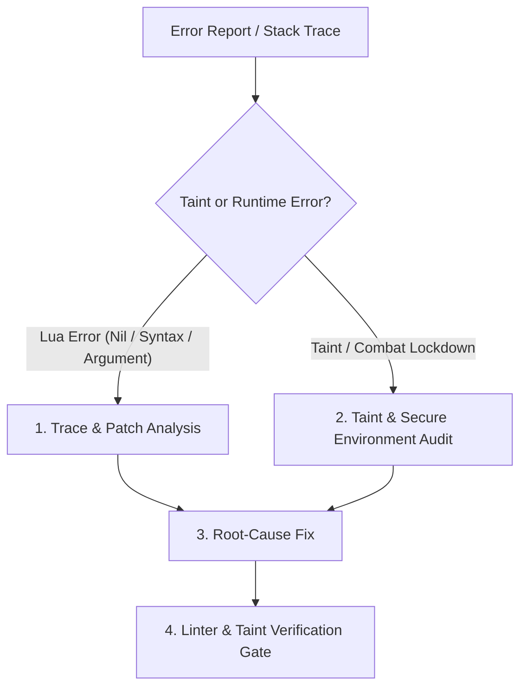

# WoW Addon Troubleshooting & Taint Diagnosis Skill

This skill guides an agent through diagnosing, isolating, and fixing World of
Warcraft addon bugs, runtime exceptions, execution taint, combat lockdown
errors, and secret value restrictions using the **wow** MCP server.

---

## 1. When to Use This Skill

Activate this skill whenever:

- The user reports a Lua error, stack trace, or addon crash.
- The game displays `"Interface action failed because of an AddOn"` (execution
  or variable taint).
- Protected actions or frame modifications fail during combat
  (`InCombatLockdown()`).
- An addon broke after a game patch or expansion release (APIs moved to `C_*`
  namespaces, return tables modified, or protected CVar changes).
- An action bar, unit frame, or raid frame becomes unresponsive in combat.

---

## 2. Troubleshooting Methodology



---

### Phase 1: Diagnosing Lua Runtime Errors

When presented with a Lua error or stack trace:

#### 1. Analyze Error Message Patterns

- **`attempt to call global '...' (a nil value)`**:
  - The function was removed or moved into a `C_*` namespace in a recent client
    patch.
  - Run `wow_api_search` or `wow_lua_lint` to identify the modern replacement:

    ```json
    { "query": "GetContainerNumSlots", "flavor": "mainline" }
    ```

- **`attempt to index field '...' (a nil value)`**:
  - Many modern APIs return a single structured table object instead of multiple
    unpacked values (e.g., `C_Item.GetItemInfo`,
    `C_Container.GetContainerItemInfo`, `C_Spell.GetSpellInfo`,
    `C_Spell.GetSpellCooldown`, `C_UnitAuras.GetAuraDataByIndex`).
  - Functions like `GetMouseFocus` were replaced by `GetMouseFoci` (returning an
    array where `[1]` is top-level).
  - Inspect return structures using `wow_api_search` and `wow_api_type_search`:

    ```json
    { "query": "C_Spell.GetSpellInfo", "flavor": "mainline" }
    ```

- **`script ran too long`**:
  - Indicates an infinite loop, recursive event trigger, or unthrottled
    iteration inside an `OnUpdate` or event handler. Throttle `OnUpdate` using
    an elapsed accumulator.

#### 2. Check Data Staleness

If an API signature seems unexpectedly different or missing, run `wow_api_stats`
and `wow_data_status` to verify whether the server's synced indexes are more
than 30 days old.

---

### Phase 2: Execution Taint & Combat Lockdown

Taint occurs when third-party addon code interacts with secure Blizzard
execution paths, preventing protected actions from executing.

#### 1. Understand Taint Rules

- **Execution Taint:** Once non-Blizzard code executes, the execution path is
  marked as tainted. Calling any protected function from this path causes an
  immediate failure.
- **Variable Taint:** Assigning a tainted value to a global table or secure
  frame property taints that variable. If Blizzard's secure UI later reads that
  variable, execution becomes tainted.

#### 2. Common Causes of "Interface action failed"

1. **Directly Calling Protected Functions:** Functions like `CastSpellByName`,
   `TargetUnit`, `AttackTarget`, `ClearOverrideBindings`, `UseAction`, and
   `SetBinding` cannot be called from generic addon Lua.
   - **Fix:** Use secure buttons inheriting `SecureActionButtonTemplate` and set
     attributes outside of combat (`type`, `spell`, `unit`).

2. **Hooking Global Blizzard Functions Incorrectly:** Never overwrite or wrap
   Blizzard functions directly:

   ```lua
   -- DANGEROUS / CAUSES TAINT:
   local orig = Frame_OnShow
   Frame_OnShow = function(...) orig(...); MyCode() end
   ```

   - **Fix:** Always use `hooksecurefunc`:

     ```lua
     hooksecurefunc("Frame_OnShow", function(...) MyCode() end)
     hooksecurefunc(BlizzardFrame, "SetPoint", function(...) MyCode() end)
     ```

3. **Modifying Protected Console Variables in Combat:** Attempting to alter
   protected CVars during combat causes taint errors.
   - **Fix:** Check `wow_cvar_search` for `secure: true`. Defer `SetCVar` calls
     until `PLAYER_REGEN_ENABLED`.

4. **Modifying Secure Frames During Combat:** Calling `Show()`, `Hide()`,
   `SetPoint()`, `ClearAllPoints()`, or `SetParent()` on secure frames while in
   combat triggers an error.
   - **Fix:** Check `InCombatLockdown()` and defer updates until
     `PLAYER_REGEN_ENABLED`:

     ```lua
     local pendingUpdate = false

     local function SafeUpdateFrame()
         if InCombatLockdown() then
             pendingUpdate = true
             return
         end
         MyFrame:SetPoint("CENTER", UIParent, "CENTER", 0, 0)
         pendingUpdate = false
     end

     local eventFrame = CreateFrame("Frame")
     eventFrame:RegisterEvent("PLAYER_REGEN_ENABLED")
     eventFrame:SetScript("OnEvent", function(self, event)
         if event == "PLAYER_REGEN_ENABLED" and pendingUpdate then
             SafeUpdateFrame()
         end
     end)
     ```

5. **Global Variable Leakage:** Accidentally assigning variables without `local`
   can overwrite stock Blizzard globals.
   - **Fix:** Always scope variables locally, or store addon data in
     `local addonName, ns = ...`.

---

### Phase 3: Retail (11.0+ & 12.0 Midnight) Secret Values & Restrictions

Recent Retail expansions introduced protected combat data boundaries:

- **`secretReturns: true`**: The function produces a secret combat-sensitive
  value. Addon code cannot inspect, serialize, concatenate, or branch on this
  value directly.
- **`secretArguments`**: Indicates whether an API accepts secret values as
  parameters and under what taint conditions (`AllowedWhenUntainted`,
  `AllowedWhenTainted`, or `NotAllowed`).
- Check whether an API has restricted flags using `wow_api_search`:

  ```json
  { "query": "UnitPosition", "flavor": "mainline" }
  ```

---

### Phase 4: Troubleshooting Verification Gate

After applying fixes:

1. **Run `wow_lua_lint` on all affected files:**

   ```json
   { "path": "Interface/AddOns/MyAddon/Core.lua", "flavor": "mainline" }
   ```

   Ensure the linter reports 0 taint warnings, 0 removed API warnings, and 0
   unknown events. Pass `knownGlobals` for external libraries.

2. **Verify Cross-Flavor Safety:** If the addon targets Classic or WoW Forever
   as well, re-lint for each:

   ```json
   { "path": "Interface/AddOns/MyAddon/Core.lua", "flavor": "vanilla" }
   ```

   ```json
   { "path": "Interface/AddOns/MyAddon/Core.lua", "flavor": "forever" }
   ```
