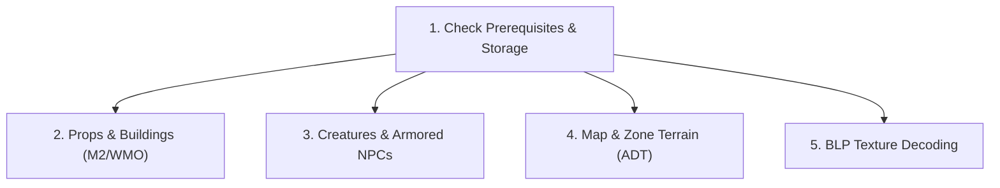

# WoW Headless 3D Model, Creature & Terrain Export Skill

This skill guides an agent through searching and extracting 3D game models (M2
creatures and props), WMO buildings, BLP textures, and ADT map terrain tiles
from a local World of Warcraft installation to glTF, OBJ, and PNG formats using
the **wow** MCP server.

---

## 1. When to Use This Skill

Activate this skill whenever:

- Exporting 3D models (creatures, props, doodads, buildings, dungeons) for use
  in Blender or other 3D software.
- Exporting creatures or NPCs with their skins, animations, worn armor geosets,
  and attached equipment models (helms, shoulders, weapons).
- Decoding `.blp` game textures into standard `.png` images.
- Exporting zone terrain tiles (ADT) with blended textures, alpha masks, or
  placed buildings and props.
- Resolving listfile paths or FileDataIDs for game models and map instances.

---

## 2. 5-Step Export Workflow



---

### Step 1: Verify Install & Sync Prerequisites

The model exporter reads directly from local CASC storage files on disk and
requires synced metadata tables:

1. **Verify Local Installation:** Call `wow_install_info` to confirm detected
   installation paths and flavors (`mainline`, `forever`, `classic`, `vanilla`):

   ```json
   {}
   ```

2. **Verify Synced Data Sets:** Call `wow_data_status` to ensure data sets are
   present:

   ```json
   {}
   ```

   All 7 model and terrain export tools require two prerequisites:
   - **`sync game-data`**: Fetches the community FileDataID listfile
     (`community-listfile.csv`).
   - **`sync model-data`**: Fetches WoWDBDefs column definitions (`.dbd`) and
     TACTKeys decryption keys. Data synced prior to server version 0.8.0 must
     re-run `sync model-data` to acquire NPC equipment tables
     (`NPCModelItemSlotDisplayInfo.dbd`).

   > [!NOTE] The first tool call that opens CASC storage (`wow_model_export`,
   > `wow_creature_search`, `wow_creature_export`, `wow_map_search`,
   > `wow_map_export`, or `wow_texture_export`) takes approximately 30–40
   > seconds while storage indexes load. Subsequent operations run quickly.

---

### Step 2: Search & Export Props, Doodads & Buildings (M2 & WMO)

1. **Search Models in the Listfile:** Call `wow_model_search` with keywords or a
   numeric `FileDataID` (searches the shared listfile; does not require a
   `flavor` parameter):

   ```json
   { "query": "elwynn tower", "kind": "wmo" }
   ```

   Or for an M2 prop:

   ```json
   { "query": "chest", "kind": "m2", "limit": 20 }
   ```

2. **Export the Model:** Call `wow_model_export` specifying the model FileDataID
   or listfile path and an output folder:

   ```json
   {
     "model": "world/wmo/azeroth/buildings/guardtower/human_guardtower.wmo",
     "outputDir": "exports/tower",
     "splitGroups": true
   }
   ```

   - **M2 Models (Props & Creatures):** Exported as `gltf` by default with
     skeletal animations enabled (`animations: true`). M2 blend modes are
     preserved via glTF `alphaMode` and `extras.wowBlend`. Also supports
     `"format": "glb"` or `"obj"`.
   - **WMO Models (Buildings & Dungeons):** Exported as `obj` + `mtl` by default
     (or `"format": "gltf"`). Material paths use forward slashes so relative
     textures resolve cleanly in Blender.
   - Textures are decoded to `.png` beside the model matching the internal game
     path layout.

---

### Step 3: Search & Export Creatures & Armored NPCs

1. **Search Creatures and NPCs:** Call `wow_creature_search` to find creatures
   by name, creature ID, or display ID:

   ```json
   { "query": "Varian Wrynn", "flavor": "mainline" }
   ```

   The tool reports the creature `id`, `name`, `displayID`, model FileDataID,
   and whether the creature is `humanoid`.

2. **Export the Creature Model:** Call `wow_creature_export` using `creatureId`
   or `displayId`:

   ```json
   {
     "creatureId": 29611,
     "outputDir": "exports/varian",
     "format": "gltf",
     "animations": true,
     "equipment": true
   }
   ```

   **Output Features:**
   - **Beasts & Monsters:** Exported with their expansion display skin textures
     and geosets.
   - **Humanoid NPCs (Player Race Models):** Automatically configured with the
     correct race and sex base mesh, character customization geosets (hair,
     beard, features), baked NPC skin textures, and worn armor geosets (boots,
     robes, tabards).
   - **Attached Equipment:** Helms (slot 1), shoulder armor (slot 3), and
     weapons (slots 16/17) are exported as separate models placed beside the
     character. The tool response details each attachment's target bone name and
     local Z-up offset for parenting in Blender.

---

### Step 4: Search & Export Zone Terrain (ADT Map Tiles)

1. **Search Maps & World Positions:** Call `wow_map_search` to look up map
   directories or find the tile holding a specific world coordinate:

   ```json
   {
     "query": "Kalimdor",
     "x": -1280.0,
     "y": 120.0,
     "flavor": "mainline"
   }
   ```

   The tool returns the `mapId`, internal `directory`, and tile coordinates
   `a,b` (e.g., `31,34`).

2. **Export Map Terrain Tiles:** Call `wow_map_export` with the `mapId` and tile
   coordinates or world `(x, y)`:

   ```json
   {
     "mapId": 1,
     "tiles": [[31, 34]],
     "outputDir": "exports/kalimdor",
     "texture": "tex0",
     "objects": false
   }
   ```

   - **`texture` Modes:**
     - `"tex0"` (default): Blends all terrain texture layers into a single
       `.png`.
     - `"alpha"`: Writes raw layer textures alongside individual alpha blend
       masks.
     - `"none"`: Exports terrain mesh geometry only without textures.
   - **`objects: true`**: Optionally exports and places the tile's WMO buildings
     and M2 doodads in world position.
   - Files are written to `<outputDir>/maps/<directory>/`.

---

### Step 5: Export Individual BLP Textures as PNG

To decode any `.blp` game texture into a standard `.png` image, call
`wow_texture_export`:

```json
{
  "texture": "interface/icons/inv_sword_04.blp",
  "outputDir": "exports/textures",
  "flavor": "mainline"
}
```

Accepts either a listfile path or a numeric `FileDataID` (e.g., `135349`).
Writes the converted `.png` to `outputDir`, creating any necessary parent
folders.
